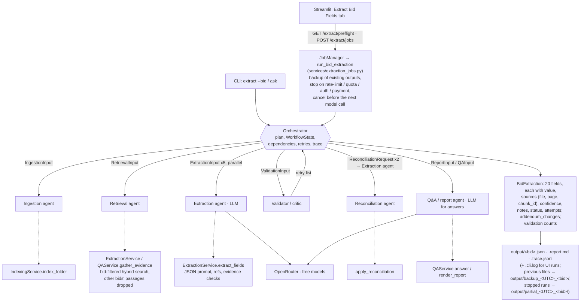

# RFP Intelligence Platform — RAG Search Engine and Multi-Agent Extraction

A hybrid search engine over bid / RFP documents (PDF + HTML, including addendums) that returns
**cited passages** and **grounded answers** from free OpenRouter models. A multi-agent workflow
(§2b) uses it to extract the 20 Section 8 fields per bid as cited JSON and to answer questions. The
system is covered by offline tests with stub models and has been run live on Bid1, Bid2 and an
unseen RFP (`Bid5_Unseen_RFP`, §3).

## Demo video

▶️ [Watch the demo on Google Drive](https://drive.google.com/file/d/1LUvxr08UdQ0RoUiHRCjj8dXIzuF-v79c/view?usp=sharing)

## Key features

* **Parsing:** Docling for PDFs (layout, TableFormer tables, OCR) with a PyMuPDF fallback and a
  RapidOCR fallback for scanned pages; BeautifulSoup for HTML bid pages.
* **Chunking:** heading- and table-aware chunks; every chunk carries bid, file, page, doc type,
  addendum number and section.
* **Retrieval:** local dense embeddings (`BAAI/bge-small-en-v1.5`) in ChromaDB + BM25, fused with
  Reciprocal Rank Fusion and re-ranked by a cross-encoder (`ms-marco-MiniLM-L-6-v2`); metadata
  filters and RFP query expansion.
* **Incremental indexing:** content-hash manifest, deterministic chunk ids, deduplication, pruning,
  safe uploads.
* **Extraction:** 20 fields with citations, evidence-based confidence, validation, bounded retries
  and addendum reconciliation; JSON, Markdown report and JSON-lines agent trace per bid.
* **Interfaces:** FastAPI, CLI, and a Streamlit UI (Search, Ask, Upload & index, Indexed documents,
  Extract Bid Fields).
* **LLM:** OpenRouter, restricted to free models (verified at runtime), no silent model switch.

---

## 1. Quick start

```powershell
# from the project root (the folder that contains Bid1/ and Bid2/)
python -m venv .venv
.venv\Scripts\activate            # macOS/Linux: source .venv/bin/activate
pip install -r requirements.txt
copy .env.example .env            # then set OPENROUTER_API_KEY in .env (not needed for search)

python main.py index --all        # parse + index Bid1, Bid2 and any uploads (~4.5 min first time on CPU)
python main.py up                 # FastAPI on :8000 + Streamlit UI on :8501
```

Open <http://localhost:8501> (UI) or <http://127.0.0.1:8000/docs> (API docs).

* The first run downloads the Docling layout/table/OCR models (into `data/models/docling`), the
  embedding model and the cross-encoder. Later runs work offline except for OpenRouter calls.
* `main.py up` prefixes the two servers' logs with `[api]` / `[ui]`, refuses to start if port 8000
  or 8501 is already in use, and stops both if either exits. `LOG_LEVEL=DEBUG` also shows the UI's
  polling requests.
* Windows: Docling models are stored as plain files (no Developer Mode needed); `config.py` sets
  `USE_TF=0` to avoid a broken global TensorFlow install.

### API key and `.env`

1. Set `OPENROUTER_API_KEY` **only in `.env`**. `.env` is git-ignored; `.env.example` is committed
   with an empty key.
2. The key is read by `config.py` and sent only in the `Authorization` header. It is never logged
   or returned: `/models` and the UI report only `api_key_configured: true/false`, and every LLM
   error message passes through `redact()`, which removes the key and anything shaped like `sk-or-…`.
3. `python main.py models` checks the configured models' free status without printing the key.
4. Recommended (the `.env.example` defaults): `LLM_MAX_TOKENS=2048`, `LLM_REASONING_EFFORT=low`.
   Reasoning models spend part of the budget on thinking; at 800 tokens some returned empty answers.

### Models

* Only models listed in `LLM_MODELS` / `LLM_FALLBACK_MODELS` can be called; any other ID is
  refused before a request is sent. The UI lists only models whose catalogue price is zero
  (`verified_free`, or `unverified` if the catalogue is unreachable).
* **`LLM_DEFAULT_MODEL`** (`google/gemma-4-31b-it:free` in `.env`, `.env.example` and `config.py`)
  is used by Ask and by `main.py extract` without `--model`.
* **`EXTRACT_DEFAULT_MODEL`** (`config.py` default `nvidia/nemotron-3-ultra-550b-a55b:free`) is
  preselected in the Extract Bid Fields tab and can be changed there.
* All live extraction runs used `nvidia/nemotron-3-ultra-550b-a55b:free`. Free-model availability
  changes often; check with `python main.py models` and
  `python -m eval.llm_e2e --compare-models` before choosing a default.
* Optional `LLM_FALLBACK_MODELS` (free only) is tried only after rate limits, timeouts, 5xx,
  model-unavailable or invalid responses.

### CLI commands

| Command | What it does |
|---|---|
| `python main.py index --all` / `--bid ./NewBid` / `--rebuild` / `--force` | Index all bid folders and uploads / one folder (bid id = folder name) / wipe and rebuild / re-process unchanged files |
| `python main.py search "bid bond" --bid-id Bid1 --top-k 5 --mode hybrid_rerank` | Cited search |
| `python main.py ask "Which affidavits are required?" --bid-id Bid2 [--trace ask.jsonl]` | Grounded Q&A via the Retrieval → Q&A agents (needs API key) |
| `python main.py extract --bid Bid1 [--model ID] [--workers 1] [--out output]` | Extract the 20 fields → `output/Bid1.json`, `.report.md`, `.trace.jsonl` (needs API key) |
| `python main.py extract --bid ./SomeNewBidFolder` | Index the folder incrementally, then extract |
| `python main.py models` · `python main.py status` | Model free-status check · indexed bids/documents/chunks |
| `python main.py up` · `serve` · `ui` | API + UI · API only · UI only |
| `python -m eval.evaluate [--no-filter]` | Retrieval evaluation → `eval/results/` |
| `python -m eval.llm_e2e [--model ID] [--compare-models]` | Live Q&A checks against the running API (uses free-tier requests) |
| `python -m eval.score_extraction [--out output] [--bids Bid1 Bid2]` | Score extraction JSON against `eval/extraction_expected.json` (offline; overwrites `eval/results/extraction_accuracy.*`) |
| `python -m pytest -m "not slow"` | Offline test suite |

### Docker

**Prerequisites:** Docker with the Compose plugin (Docker Desktop on Windows/macOS), and a `.env`
file in the project root (`copy .env.example .env`, then set `OPENROUTER_API_KEY`).

```powershell
docker compose up --build -d                          # build the image and start API + UI
docker compose exec rfp python main.py index --all   # first run: index Bid1/Bid2 inside the container
docker compose logs -f rfp                            # follow the [api] / [ui] logs
docker compose down                                   # stop and remove the container (volumes are kept)
```

Open <http://localhost:8501> for the UI and <http://localhost:8000/docs> for the API docs. The
container runs the same startup command as locally (`python main.py up`); the local commands above
keep working unchanged.

* **Environment:** `.env` is read at runtime through `env_file` and is excluded from the image by
  `.dockerignore`, so the API key is never baked into the image. Compose overrides `API_HOST=0.0.0.0`,
  `API_URL=http://127.0.0.1:8000` and `STREAMLIT_SERVER_ADDRESS=0.0.0.0` so both servers are
  reachable from the host.
* **Persistent data:** two named volumes, `rfp_data` (`/app/data`: index, uploads, downloaded
  Docling and Hugging Face models) and `rfp_output` (`/app/output`: extraction outputs). They are
  separate from the host's `data/` and `output/` folders, which the container never touches.
  `docker compose down -v` deletes the volumes. Copy outputs to the host with
  `docker compose cp rfp:/app/output ./docker-output`.
* **Bid folders:** `Bid1/` and `Bid2/` are mounted read-only; uploads made in the UI go to the
  `rfp_data` volume.
* The image uses CPU-only PyTorch (`EMBEDDING_DEVICE=cpu`). The first indexing run downloads the
  models into `rfp_data`; later starts reuse them.

---

## 2. Architecture

System overview: entry points, ingestion, index, the Search and Ask paths, and where extraction
plugs in. Dashed arrows are fallbacks.

```mermaid
flowchart LR
  subgraph Entry["Entry points"]
    CLI["CLI main.py<br/>index · search · ask · extract"]
    UI["Streamlit app.py<br/>Search · Ask · Upload & index ·<br/>Indexed documents · Extract Bid Fields"]
    UI -->|HTTP| API["FastAPI api/routes.py"]
  end
  API -->|"POST /upload"| UP["data/uploads/&lt;bid_id&gt;/"]
  API -->|"/index/jobs · /extract/jobs"| JM["JobManager<br/>one background job at a time,<br/>progress + cancel"]
  CLI -->|index| IX
  JM -->|index job| IX["IndexingService<br/>incremental, hash dedup, prune"]
  subgraph Ingestion
    F["Bid folders Bid*/ + uploads<br/>PDF + HTML"] --> L[DocumentLoader]
    L -->|PDF| D["Docling<br/>layout + TableFormer + OCR"]
    D -.Docling fails.-> M[PyMuPDF]
    D --> OF["Fallback OCR (when OCR is on)<br/>RapidOCR on PyMuPDF page images,<br/>scanned / image pages only"]
    M --> OF
    L -->|HTML| B["BeautifulSoup<br/>chrome removal, label/value, tables"]
    OF --> C["Cleaner<br/>unicode, whitespace, hyphenation,<br/>running headers/footers"]
    B --> C
    C --> MD["Metadata<br/>bid_id, doc_type, addendum_number,<br/>document_date, page"]
    MD --> CH[Heading/table-aware Chunker]
  end
  UP --> F
  IX --> L
  CH --> E[Embedder bge-small] --> V[("ChromaDB<br/>persistent")]
  CH --> MF[("manifest.json<br/>hashes, status, version")]
  V --> BM["BM25 index<br/>rebuilt from Chroma on manifest change"]
  subgraph Retrieval["Retrieval (RetrievalService → HybridSearcher)"]
    Q["Query + metadata filters<br/>bid_id · doc_type · addendum_number"] --> X[Query expansion] -->|keyword query| BM
    Q -->|dense query| V
    V --> R[RRF fusion]
    BM --> R
    R --> RR[Cross-encoder rerank] --> TK["Top-K cited results<br/>file · page · chunk_id"]
  end
  API -->|"GET /search"| Q
  CLI -->|search| Q
  TK -->|Search| SR[Ranked passages to UI / CLI]
  API -->|"POST /ask"| QA
  QA["QAService.ask<br/>evidence = top-K + hybrid extra<br/>+ addendum passages for 'latest' questions"] --> Q
  TK --> QA
  QA --> LLM["OpenRouter<br/>free models only"]
  LLM --> GA["Answer with resolved citations,<br/>grounding check, status"]
  CLI -->|"ask · extract"| AG["Multi-agent workflow §2b"]
  JM -->|extract job| AG
  AG --> Q
```



The agent layer (§2b) in detail. Solid arrows from the Orchestrator are typed handoffs; dashed
arrows show which existing service each agent wraps. Only the Extraction agent and the Q&A agent
call the model.



### Project layout

```text
config.py, schemas.py     settings (env / .env) and shared Pydantic models
main.py, app.py           CLI and Streamlit UI (the UI talks to the API over HTTP)
api/routes.py             FastAPI app
ingestion/                PDF (Docling / PyMuPDF / fallback OCR) and HTML parsing, cleaning,
                          metadata, chunking
search/                   embeddings, ChromaDB store, BM25, query expansion, reranker, hybrid search
services/                 indexing, uploads, retrieval facade, OpenRouter client, Q&A,
                          background jobs, UI/API extraction jobs (extraction_jobs.py)
extraction/               the 20-field registry, output schema, extraction service, trace
agents/                   orchestrator, shared state, typed contracts, the six agents
eval/                     retrieval questions, extraction ground truth, evaluation scripts, results/
tests/                    offline unit and integration tests (LLM mocked)
data/                     uploads/, index/ (Chroma + manifest), models/ — generated, git-ignored
output/                   extraction outputs per bid
```

`Bid1/`, `Bid2/` and the assignment PDF are only read, never modified.

### 2b. Multi-agent workflow

Own orchestration (`agents/`), no framework: a small orchestrator with typed messages and
thread-based parallelism over the existing services.

| Agent | Responsibility | Wraps | LLM |
|---|---|---|---|
| **Orchestrator** | Builds the plan, owns `WorkflowState`, runs steps in dependency order and independent work in parallel, applies the critic's retry list (bounded), contains agent failures, traces every handoff | — | no |
| Ingestion | Parse, clean, chunk and index a bid folder (incremental) | `IndexingService.index_folder` | no |
| Retrieval | Evidence restricted to one bid; other bids' passages dropped | `ExtractionService.gather_evidence` / `QAService.gather_evidence` | no |
| Extraction | Fill one field group from given evidence (JSON with refs), checked against the cited passages | `ExtractionService.extract_fields` | **yes**, one call per group |
| Validator / critic | Sources must be passages the model was shown for that field; null for `not_found`/`error`; confidence bounds; decides accept / retry / not_found / give up | deterministic rules | no |
| Reconciliation | Requests addendum-only and original-document extractions (run on the Extraction agent) and records a change only when both values are validated and differ | `apply_reconciliation` | no |
| Q&A / report | Cited answers; final JSON record and Markdown report | `QAService.answer`, `render_report` | **yes** for answers |

No model call exists just to make a function an "agent": an extraction run makes the same number
of LLM calls as the plain service path, and tests check this.

**Extraction run:** `[ingest]` (folder input only) → `check_bid` → `retrieve:<group>` ×5 →
`extract:<group>` ×5 (parallel, `--workers`, default 3; the UI uses 1) → focused retries →
`validate:1` → up to `--max-retries` rounds of wider retrieval + re-extraction + validation →
addendum reconciliation → `validate:final` → `report`.

**Question mode** (`main.py ask`): `retrieve:question` → `answer` (one LLM call, same citation,
grounding and status checks as `/ask`; the `/ask` endpoint calls `QAService.ask` directly with the
same result).

**Failures:** an agent exception fails only its step (recorded in `state.errors`); a failed
retrieval makes that group's fields `error` without an LLM call; LLM errors, invalid JSON and
truncated replies make the affected fields `error` and are retried within the limit. The report is
always produced; the CLI exits 1 if any field or agent errored.

**Trace** (`<bid>.trace.jsonl`): a `handoff` and an `agent` event per step plus `retrieve`,
`llm_call` (model, latency, tokens, finish reason), `validate`, `retry` and `reconcile` events.
Evidence appears only as chunk id / file / page references, never as text or prompts; every line is
key-redacted.

---

## 3. Structured extraction (20 fields)

`extraction/fields.py` is the single registry of the 20 Section 8 fields (names, descriptions,
groups, search queries, value kinds, addendum sensitivity). The output (`extraction/schemas.py`) is
a `BidExtraction` with `bid_id`, all 20 `fields`, `addendum_changes`, `validation` counts, `model`,
`generated_at` and `llm_calls`. Each field has `value` (null when absent or unsupported), `sources`
(file, page, chunk_id, citation, doc_type, addendum_number), `confidence`, `notes`, `status`
(`verified` / `unverified` / `not_found` / `error`) and `attempts`.

### Citations and validation

* Evidence always comes from bid-filtered search; passages from another bid are dropped and traced.
* The model answers `{field: {value, refs, notes}}` over numbered passages. Unknown refs are rejected
  and a value without a valid ref becomes null. Cited values are checked against their passages:
  numbers and dates grounded, identifiers / emails / phones verbatim, word overlap for text.
* Long table passages are sent whole or as a bounded excerpt of the relevant rows (with section
  heading and metadata), never blindly cut.
* Completeness checks are negation-aware ("warranty not found" does not count as a warranty) and
  Unicode-normalised.
* Field-specific clean-up: Payment Terms keep only the agency's terms (subcontractor / financing
  clauses removed); a bid due date mixed into Delivery Date is removed; an uncited "None" is
  `not_found`.
* **Confidence** is computed from evidence, never from the model:
  `0.35·citation + 0.35·support + 0.15·format + 0.15·retrieval`; unverified values are capped at
  0.5 and not-found fields at 0.6.

### Retries (all bounded)

* Retry rounds use a wider search; `error` fields are always retried, `unverified` ones only when
  new evidence appears. A retry result replaces the earlier one only if it is better.
* Focused single-field retries (at most 8 per bid) when a passage contains the field's
  characteristic wording but the field is `not_found`, or a verified value is incomplete (e.g. a
  stated warranty or a dock model missing).
* A group whose reply hits the token limit is split in half (at most 2 levels); a single field that
  is still cut off gets one compact retry (at most 3 per bid). Identical requests are never resent.

**Addendum reconciliation:** for addendum-sensitive fields, one addendum-only request per group;
original-document requests only for fields with a validated, substantive addendum value. A change
is recorded (with `previous_value` and `previous_sources`) only when both values are validated, the
model labels a real change, the addendum passage contains change wording, and the values differ in
substance. Clarifications and rewordings are not recorded.

**Outputs:** `output/<bid>.json`, `<bid>.report.md`, `<bid>.trace.jsonl`; UI runs also write
`<bid>.cli.log`. CLI exit codes: 0 written; 1 written with field or agent errors; 2 not run (unknown
bid or missing key, nothing sent to the LLM).

### Extract Bid Fields (UI)

The **🧾 Extract Bid Fields** tab runs the same pipeline as a background job
(`services/extraction_jobs.py`):

* lists indexed bids, the selected bid's documents with doc type and detected addendum number, the
  output paths, an estimated 14–32 requests and a model selector;
* starts only after explicit confirmation (a second confirmation if outputs exist);
* backs up existing outputs to `output/backup_<UTC>_<bid>/` and verifies them byte for byte before
  any model call (the run aborts if the backup fails);
* stops all further model requests after a rate-limit, quota, authentication or payment error and
  writes the incomplete record to `output/partial_<UTC>_<bid>/` instead of replacing `<bid>.json`;
  cancel stops before the next model call and writes nothing.

### Live extraction runs

All runs used `nvidia/nemotron-3-ultra-550b-a55b:free`. Counts are the pipeline's own validation
statuses from each run's log:

| Bid | How | Run (UTC) | LLM calls | Verified | Not found | Addendum changes |
|---|---|---|---|---|---|---|
| Bid1 | CLI | 2026-10-24 | 18 | 15 | 5 | 2 |
| Bid2 | CLI | 2026-10-24 | 14 | 16 | 3 (+1 unverified) | 0 |
| Bid1 | UI tab (current `output/Bid1.*`) | 2026-10-25 04:57–05:09 | 23 | 14 | 6 | 1 |
| Bid2 | UI tab (current `output/Bid2.*`) | 2026-10-25 06:23–06:29 | 12 | 16 | 4 | 0 |
| Bid5_Unseen_RFP | UI tab | 2026-10-25 08:00–08:04 | 12 | 6 | 14 | 0 |

**Unseen-bid test (`Bid5_Unseen_RFP`).** A new procurement PDF not used during development
(`855680633-SPD-RFP-Works-EPC-Turnkey-Single-Stage-SEASH-FEB-2025.pdf`, an EPC/turnkey works RFP)
was uploaded and indexed through the UI (574 chunks), and Search and Ask were tested on it.

* The first extraction attempt (07:41 UTC) stopped at OpenRouter's daily free-model limit; as
  designed, no further requests were sent and the incomplete record was written to
  `output/partial_20261025T074448Z_Bid5_Unseen_RFP/`.
* The second attempt, after switching the OpenRouter model, completed: **6 verified** and
  **14 not_found** fields, 0 errors. Its log records `nvidia/nemotron-3-ultra-550b-a55b:free`.
* Verified fields: Bid Submission Type, Installation, Bid Bond Requirement (proposal security),
  Payment Terms, Any Additional Documentation Required and Bid Summary.
* **Caveat:** "verified" means the value passed the pipeline's evidence check against the passages
  it cites. The values were **not independently checked** against the document or any ground truth,
  and neither were the 14 `not_found` fields (which include Bid Number, Title, Due Date and
  company_name). There is no accuracy figure for this bid.

---

## 4. Design decisions

* **Parsing.** Docling with table structure and OCR, because the Bid1 RFP has image-only form pages
  (55–62) that only OCR recovers (~2.3–2.6 s/page on CPU). If Docling fails, PyMuPDF is used, and
  when OCR is on a RapidOCR fallback reads scanned or mostly-image pages that came back nearly
  empty. Reading-order repair and recovery of borderless SKU tables fix the two layout errors seen
  in the bid PDFs. Large PDFs are converted in 10-page batches so jobs show progress and can be
  cancelled; the UI warns before indexing large PDFs and lets the user choose OCR on or off.
* **HTML.** Navigation, cookie banners and scripts are removed; headings, tables and label/value
  pairs are kept in order. HTML has no pages, so citations name the section heading and
  `page_number` is null. Encodings (BOM, UTF-16, declared charsets, Windows-1252) are detected;
  JavaScript-only pages index only the text embedded in the saved file.
* **Metadata.** `doc_type` (`rfp`, `addendum`, `bid_page`, `specs`, `affidavit`, `other`) and
  `addendum_number` come from the file name and opening text; `document_date` from a labelled date
  in the text, else the PDF creation date.
* **Chunking.** `CHUNK_SIZE=1200` characters (~250–300 tokens) with 200 overlap: enough for a full
  clause plus its heading, well under the embedder's 512-token limit. Headings close chunks and are
  prefixed to the text; tables are separate chunks, kept whole up to 2,400 characters and otherwise
  split by rows with the header repeated; table captions travel with their table.
* **Embeddings.** `bge-small-en-v1.5` runs locally on CPU (~20 s to embed all chunks, ~28 ms per
  query), so documents never leave the machine. Larger or API models would be more accurate but
  slower, costlier or remote. The index records its model and refuses to mix models.
* **Retrieval.** BM25 keeps identifiers whole and split (`ja-207652`, `210-BLYZ`, `WD22TB4`), so
  exact-ID questions work; query expansion is applied to the BM25 query only. Weighted RRF fuses
  the top 30 candidates of each retriever, and a cross-encoder re-ranks the top 20
  (`DEFAULT_SEARCH_MODE=hybrid_rerank`, ~0.9 s/query on CPU).
* **Ask context.** The top 6 results of the requested mode, plus the top 4 plain-hybrid results
  (the reranker sometimes demotes table rows and short addendum notices) and, for "latest / revised"
  questions, the top 3 addendum passages; de-duplicated, at most 10.
* **Answers.** The model may use only the numbered passages and must cite every factual sentence
  with `[n]`; file names and pages come from chunk metadata, never from the model. A grounding check
  requires every number, date and time to appear in a passage cited in the same paragraph. Each
  answer gets a status: `verified`, `unverified`, `incomplete` (token limit), `not_found` or
  `error`.
* **Free models only.** Configured `:free` models with zero catalogue price; every request sets
  `provider.max_price = 0`; `402` is never retried; fallback only to the explicit free list.
* **Incremental indexing and uploads.** Unchanged files are skipped, changed files replace their
  old chunks, duplicates are reported, deleted files are pruned. Uploads are checked by extension,
  content and size; file names and bid ids are sanitised, and paths must stay inside `data/uploads/`.

---

## 5. API

| Method | Path | Purpose |
|---|---|---|
| GET | `/health` · `/bids` · `/documents?bid_id=` · `/models` | Status and index stats · bids with document/chunk counts · manifest rows · configured models with free-status check |
| POST | `/index` | Synchronous indexing: `{"all":true}`, `{"bid_id":…}`, `{"bid_path":…}`, `{"bid_id":…,"paths":[…]}` or `{"rebuild":true}`, optional `force` |
| POST | `/index/jobs` | Same body (plus optional `ocr`), in the background → `202 {"job_id", …}` |
| GET | `/index/jobs` · `/index/jobs/{job_id}` | Job list · status, progress, queue position, report or error (indexing and extraction jobs) |
| POST | `/index/jobs/{job_id}/cancel` | Cancel: a queued job never starts; a running job stops at the next safe point |
| POST | `/upload` | Multipart `bid_id`, `files[]`, `index`, `ocr`; returns a PDF profile (pages, images, pages without text, OCR time estimate) |
| GET | `/search?q=&bid_id=&doc_type=&addendum_number=&file_name=&top_k=5&mode=&expand=` | Cited passages |
| POST | `/ask` | `{"question", "bid_id"?, "doc_type"?, "addendum_number"?, "top_k"?, "model"?, "mode"?}` |
| GET | `/extract/preflight?bid_id=` | No model call: the bid's documents and addenda, output paths and whether they exist, key state, models, request estimate |
| POST | `/extract/jobs` | `{"bid_id", "model"?, "confirm_overwrite"?}` → extraction job (poll / cancel via `/index/jobs/…`). Rejected before any call: invalid bid id (400), bid not indexed (404), model not configured (400), key missing (400), existing outputs without `confirm_overwrite` (409) |

```bash
curl "http://127.0.0.1:8000/search?q=bid%20bond&bid_id=Bid1&top_k=3"
curl -X POST http://127.0.0.1:8000/ask -H "Content-Type: application/json" \
     -d '{"question":"What is the submission deadline after all addendums?","bid_id":"Bid1"}'
```

---

## 6. Evaluation

Retrieval quality and extraction accuracy are measured separately. The retrieval figures below do
**not** measure extraction accuracy, and neither covers `Bid5_Unseen_RFP`, which has no questions
or ground truth.

### 6.1 Retrieval (25 questions, Bid1/Bid2)

**Dataset** (`eval/questions.json`): 25 questions (13 Bid1, 12 Bid2) covering due dates and
addendum changes, meetings, contract term, warranty, submission method, specs, contacts, forms,
cooperatives, affidavits, delivery, invoicing and exact identifiers. Each lists its expected source
passages as file + page(s) + key phrase, located manually, so the labels survive re-chunking.
**Metrics:** Recall@k (≥1 relevant passage in the top k), MRR@10, binary nDCG@10. Reproduce with
`python -m eval.evaluate` and `--no-filter`; reports in `eval/results/retrieval_*.{json,md}`
(run 2026-10-24, 358 chunks).

| Configuration | Filter | R@1 | R@3 | R@5 | R@10 | MRR@10 | nDCG@10 |
|---|---|---|---|---|---|---|---|
| vector only | bid | 0.720 | 0.840 | 0.840 | 0.960 | 0.798 | 0.788 |
| BM25 only (+ expansion) | bid | 0.680 | 0.920 | 0.960 | 1.000 | 0.806 | 0.831 |
| hybrid RRF + expansion | bid | 0.800 | 0.880 | 0.960 | 1.000 | 0.866 | 0.871 |
| **hybrid + rerank (default)** | bid | **0.800** | **0.960** | 0.960 | **1.000** | 0.860 | **0.876** |
| vector only | none | 0.560 | 0.680 | 0.720 | 0.880 | 0.650 | 0.659 |
| BM25 only (+ expansion) | none | 0.640 | 0.920 | 0.920 | 0.960 | 0.772 | 0.785 |
| hybrid RRF + expansion | none | 0.680 | 0.840 | 0.880 | 0.960 | 0.772 | 0.781 |
| **hybrid + rerank (default)** | none | **0.760** | **0.960** | **0.960** | **1.000** | **0.840** | **0.851** |

* Vector-only is weakest on exact identifiers and form tables; fusing with BM25 raises R@1 from
  0.72 to 0.80 with the bid filter.
* The cross-encoder is clearly best without a filter (MRR 0.840, R@10 1.0); with the filter its MRR
  is within noise of plain hybrid (0.860 vs 0.870). Variants that fuse the reranker rank or add an
  addendum vote did not help and stay off (full tables in `eval/results/`).
* **Limitations:** a small set written by the system's developer, so the numbers are optimistic;
  labels are strict and were not tuned after seeing results.

### 6.2 Extraction accuracy (Bid1/Bid2 only, historical)

`eval/score_extraction.py` scores an extraction JSON against `eval/extraction_expected.json`
(per-field 1 / 0.5 / 0 with source checks). The stored results in
`eval/results/extraction_accuracy.*` — **Bid1 90.0%, Bid2 85.0%, overall 87.5%** — are
**historical**: they were generated on 2026-10-24 from earlier outputs and have not been
regenerated for the current `output/Bid1.json` and `output/Bid2.json`. Bid5 has no ground truth
and no accuracy score.

### 6.3 Live Q&A checks (OpenRouter, 2026-10-24)

`python -m eval.llm_e2e` against the live API; each answer graded automatically (required facts,
expected file+page cited, no other-bid citations, no ungrounded values) and read manually. Raw
outputs: `eval/results/llm_e2e_run1.json` and `llm_e2e_rerun_*.json`. Every call reported
`cost: 0.0`.

| # | Question (bid filter) | Result with `nemotron-3-ultra-550b-a55b:free` | Cited |
|---|---|---|---|
| Q1 | Revised submission deadline (Bid1) | ✅ July 9, 2024 at 2:00 PM CST, by Addendum 2 | Addendum 2 …pdf, p. 1 |
| Q2 | Original deadline before the addendum (Bid1) | ✅ 27-JUN-2024 14:00:00, later extended to July 9 | JA-207652 …FINAL.pdf, p. 2; Addendum 2, p. 1 |
| Q3 | Processor, memory, storage in the Dell spec (Bid2) | ✅ Intel Core Ultra 5 125U; 16 GB DDR5; 256 GB NVMe SSD | Dell_Laptop_Specs.pdf, p. 1 |
| Q4 | Initial and maximum contract term (Bid1) | ✅ 3 years + two 1-year renewals = 5 years | JA-207652 …FINAL.pdf, p. 2 |
| Q5 | Contract Affidavit on financial disclosure (Bid2) | ✅ $100,000 threshold, file within 30 days | Contract_Affidavit.pdf, p. 1 |
| Q6 | General liability insurance amount (Bid2), not in the documents | ✅ "not found", no guess | — |
| Q7 | "What is the submission deadline?" with `bid_id=Bid2` | ✅ June 10, 2024 at 2:00 PM EDT; no Bid1 date | PORFP …pdf, p. 1; BidNet page |

* 7/7 correct with Nemotron 3 Ultra (4–69 s per answer); Nemotron 3.5 Lightning answered 2/2.
  Every cited file and page was checked against the source documents; bid isolation held.
* Two issues found live and fixed: the reranker had pushed Addendum 2 out of the answer context
  (fixed by the Ask context union, §4), and models presented the PDF creation date as an addendum's
  issue date (metadata dates removed from passage headers; both questions then passed).

Representative answer:

> **Q: What was the original submission deadline before the addendum?**
> The original submission deadline was **27-JUN-2024 14:00:00** (June 27, 2024 at 2:00 PM) as
> listed in the RFP's Bid Activities schedule [7]. Addendum No. 2 later extended the due date to
> **July 9, 2024 at 2:00 PM CST** [2].
> *[7] → JA-207652 … FINAL.pdf, p. 2 · [2] → Addendum 2 … .pdf, p. 1*
